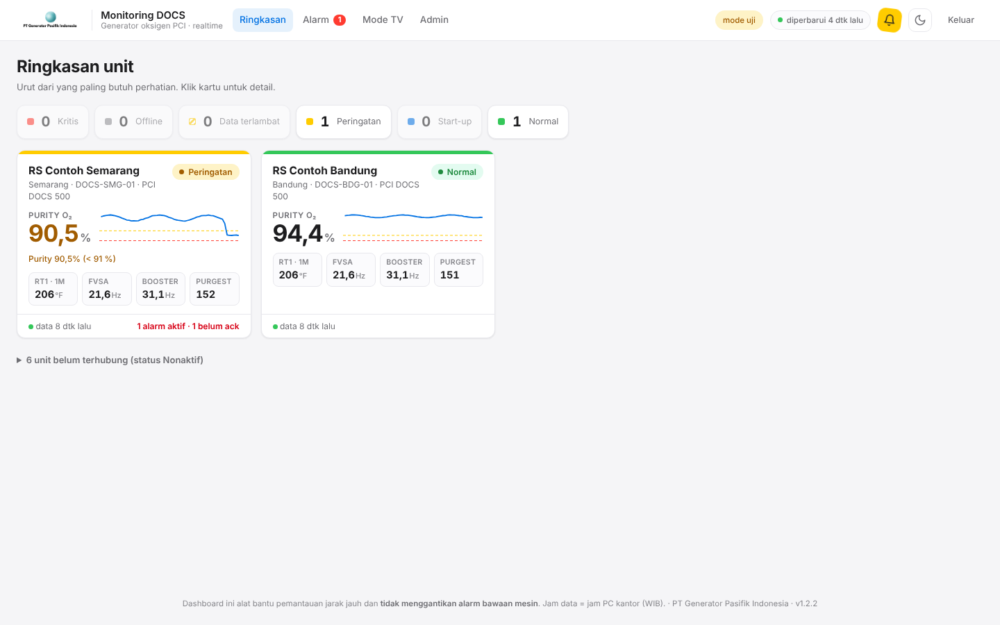
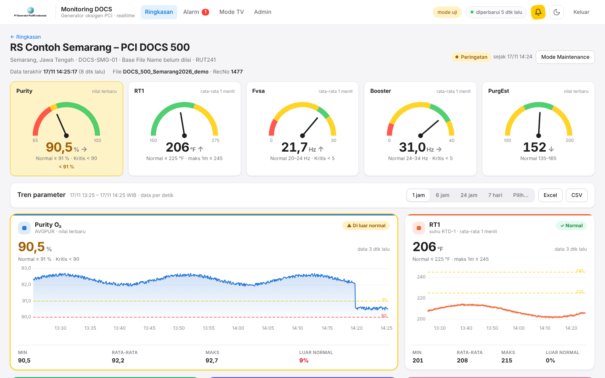
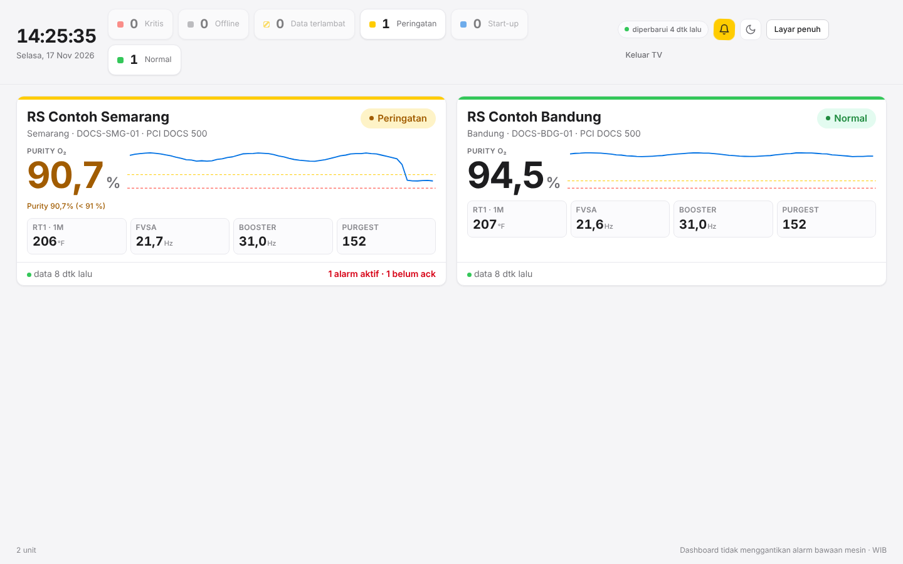
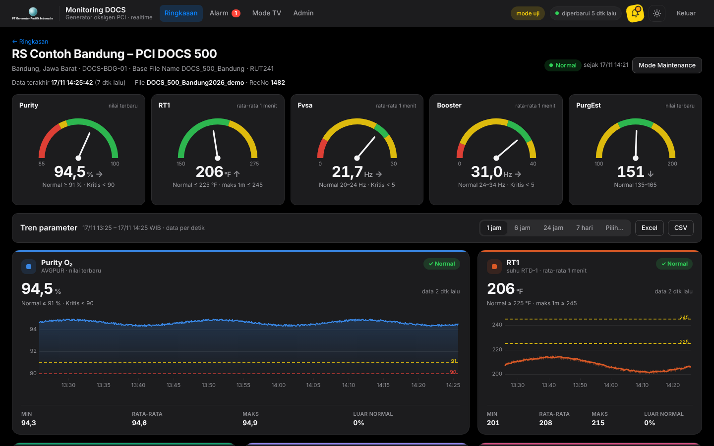

# Dashboard Monitoring DOCS

Dashboard realtime untuk memantau oxygen generator PCI DOCS yang terpasang di rumah sakit, langsung dari kantor. Data log mesin dibaca dari DOCSApp, disimpan ke MySQL, lalu ditampilkan sebagai kartu status, grafik tren, dan alarm yang bisa di-ack oleh teknisi.



## Tentang project ini

Project ini saya kerjakan selama magang di PT Generator Pasifik Indonesia. Mesin DOCS di beberapa rumah sakit sudah tersambung ke kantor lewat router dan VPN, dan datanya bisa direkam DOCSApp ke file Excel. Masalahnya, belum ada tampilan yang bisa dipantau terus-menerus, dan belum ada yang memberi tahu tim kalau ada parameter mesin yang keluar batas. Dashboard ini mengisi celah itu.

Pengerjaannya pakai pendekatan *vibe coding*. Saya menyusun kebutuhan, alur data, dan aturan alarmnya dari dokumen requirement dan diskusi dengan tim teknisi, lalu kodenya ditulis bersama AI assistant. Bagian saya lebih banyak di mendefinisikan masalah, menguji hasilnya dengan data log asli, dan memutuskan trade-off saat implementasi.

Beberapa hal yang saya pelajari dari project ini:

- Membangun pipeline data dari workbook Excel yang sedang terbuka (lewat xlwings) ke MySQL tanpa data ganda.
- Merancang mesin alarm yang tidak gampang memunculkan alarm palsu: ada delay sebelum alarm aktif, histeresis saat pulih, dan penahanan alarm purity saat mesin baru start.
- Mengelola data time-series di MySQL: agregat per menit dan retensi otomatis.
- Menyiapkan aplikasi supaya bisa jalan sendiri di PC Windows kantor: autostart, backup harian, dan aturan firewall.

## Alur data

```
Controller DOCS di RS -> router + VPN -> PC kantor (DOCSApp -> log Excel)
    -> bridge/docs_ke_mysql.py -> MySQL
    -> server/app.py (web dashboard + mesin alarm + notifikasi)
```

## Fitur

- **Ringkasan**: satu kartu per unit, diurutkan dari yang paling butuh perhatian (Kritis, Offline, Data terlambat, Peringatan, Start-up, Normal), lengkap dengan sparkline purity.
- **Detail unit**: gauge untuk 5 parameter utama, grafik tren 1 jam sampai 7 hari dengan garis ambang, timeline status 24 jam, ekspor Excel/CSV, dan mode maintenance.
- **Mesin alarm**: ambang per jenis mesin atau per unit, ack per event dengan catatan, notifikasi ulang dan eskalasi ke supervisor kalau alarm Kritis belum di-ack.
- **Notifikasi** lewat email (SMTP) dan Telegram, dengan mode uji yang hanya mencatat pesan tanpa mengirim.
- **Suara alarm** di browser yang bisa diatur per PC: level yang berbunyi, jenis suara, volume, sampai upload file suara sendiri.
- **Mode TV**: layar penuh untuk monitor di kantor, berganti unit otomatis dan berhenti di unit yang Kritis.
- **Admin**: kelola RS dan unit, ambang alarm, penerima notifikasi dan jadwal on-call, pengguna (Admin, Teknisi, Viewer), audit log, dan status sistem.
- Password di-hash, ada batas percobaan login dan proteksi CSRF.
- Light dan dark mode.

| Detail unit | Mode TV | Dark mode |
|---|---|---|
|  |  |  |

## Tech stack

Python (Flask + Waitress), MySQL 8 (juga jalan di MariaDB), JavaScript tanpa framework, [uPlot](https://github.com/leeoniya/uPlot) untuk grafik, xlwings untuk membaca Excel, serta PowerShell dan batch script untuk deploy di Windows.

## Struktur folder

```
.
├── bridge/          pembaca log DOCSApp (Excel) ke MySQL
├── database/        skema SQL dan pembuatan user MySQL
├── server/
│   ├── app.py       web dashboard dan API
│   ├── engine.py    mesin alarm, agregat, retensi
│   ├── notifikasi.py
│   ├── replay_uji.py
│   ├── buat_admin.py
│   ├── templates/
│   └── static/
└── skrip/           jalankan, restart, autostart, backup
```

## Instalasi

1. **Database.** Ganti semua `GANTI_PASSWORD` di folder `database/`, lalu jalankan dengan akun DBA secara berurutan: `01_skema_telemetri.sql`, `00_user_bridge_INSTALL_BARU.sql`, dan `02_skema_dashboard.sql`. File `03_user_PC_BARU.sql` dipakai kalau database dipindah ke PC lain.
2. **Paket Python.**
   ```
   pip install -r requirements.txt
   ```
3. **Pengaturan.** Salin `server/pengaturan_dashboard.contoh.ini` menjadi `server/pengaturan_dashboard.ini`, dan `bridge/pengaturan_mysql.contoh.ini` menjadi `bridge/pengaturan_mysql.ini`. Isi password-nya sesuai langkah 1. Kedua file hasil salinan ini sudah masuk `.gitignore`.
4. **Akun Admin pertama.**
   ```
   cd server
   python buat_admin.py
   ```
5. **Jalankan.** Klik dua kali `skrip/JALANKAN_SEMUA.bat`, lalu buka `http://localhost:8080`.
6. **Opsional.** Jalankan `skrip/pasang_autostart.ps1` sebagai Administrator untuk autostart saat login, backup harian, dan membuka port di firewall.

Bridge hanya bisa jalan di Windows yang memakai Excel dan DOCSApp. Dashboard-nya sendiri bisa dijalankan di OS apa pun selama ada MySQL atau MariaDB.

## Menguji alarm tanpa mesin

```
cd server
python replay_uji.py --unit DOCS-BDG-01 --skenario semua
python replay_uji.py --unit DOCS-BDG-01 --statistik --hari 7
```

Perintah pertama memutar ulang data telemetri lewat mesin alarm yang sama dengan versi live, lalu menjalankan beberapa skenario uji (purity turun, lonjakan suhu sesaat, start-up). Tidak ada data yang ditulis dan tidak ada notifikasi yang dikirim. Perintah kedua menghitung persentil tiap parameter untuk kalibrasi ambang.

## Keputusan desain

- **Web dashboard sendiri, bukan Grafana.** Ack per event, mode maintenance, ambang per unit dengan audit, dan aturan delay serta start-up lebih mudah dirawat dalam satu program kecil. Grafana tetap bisa dipasang nanti untuk analisis karena datanya ada di MySQL.
- **MySQL, bukan database time-series khusus.** Volume datanya masih kecil, jadi agregat per menit dan retensi cukup dikerjakan oleh mesin alarm.
- **Waktu disimpan dalam jam PC kantor (WIB).** Semua log dibaca dari PC yang sama, jadi konversi ke UTC justru menambah risiko salah jam.

## Catatan

- Semua data lokasi di repo ini dummy (RS Contoh Bandung, Semarang, dan seterusnya). Screenshot diambil dari data simulasi.
- Dashboard ini alat bantu pemantauan jarak jauh dan tidak menggantikan alarm bawaan mesin.
- uPlot dipakai dengan lisensi MIT, lihat `server/static/vendor/uPlot-LICENSE.txt`.
